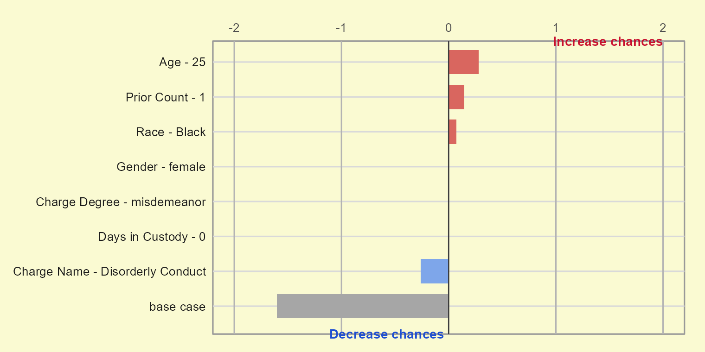
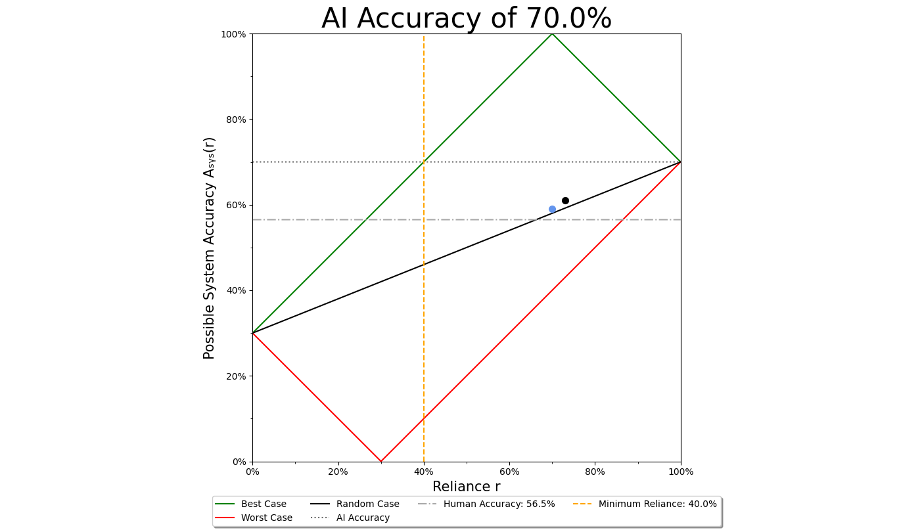

```{r setup, include = FALSE}
knitr::opts_chunk$set(echo = TRUE, message = FALSE, warning = FALSE,
                      fig.width = 7, fig.height = 4, dpi = 150, dev.args = list(bg = "#fdf6e3"))
suppressPackageStartupMessages({
  library(dplyr); library(tidyr); library(readr); library(ggplot2); library(lme4); library(knitr); library(here)
})
here::i_am("analysis/02_pilot_analysis.Rmd")
ap <- function(...) here("analysis", ...)
source(ap("helpers.R"))
set.seed(72)

if (!file.exists(ap("data", "processed", "participants.csv")))
  stop("Run 01_import_clean.R first.")
parts_all  <- read_csv(ap("data", "processed", "participants.csv"), show_col_types = FALSE)
trials_all <- read_csv(ap("data", "processed", "trials_long.csv"),  show_col_types = FALSE)
excl_log   <- read_csv(ap("data", "processed", "exclusion_log.csv"), show_col_types = FALSE)

prep <- function(d) d %>% mutate(condition = factor(condition, levels = cond_levels),
                                 cond = factor(cond_labels[as.character(condition)],
                                               levels = cond_labels))
parts  <- parts_all  %>% filter(included) %>% prep()
trials <- trials_all %>% filter(included) %>% prep() %>%
  mutate(pos_c = position - 4.5)      # case position 1-8, centred
```

## Pilot Report:

This report is based on the preregisterd analysis of the pilot ([AsPredicted #324733](https://aspredicted.org/j9rg5y.pdf)).

I set up the Qualtrics and data collection was done on the week 16-20.11.2026 at the University of Maastricht. 

Procedure:
Everyone saw the AI's prediction together with its feature-contribution explanation. (According to Wang, 2023)
Participants were randomly assigned to receive **outcome feedback** after each case or **no feedback**.
Each participant made an initial and a final prediction for 8 cases, drawn at random from 40.

Example for AI explanation for a case: 

```{r my-figure, echo=FALSE, fig.cap="Caption text", out.width="60%", fig.align="center"}


```

**Preregistered dependent variables:** accuracy of the final prediction (primary), accuracy of the initial prediction, and appropriate reliance on the AI advice, measured as in Schoeffer et al. (2023).

**Preregistered test:** a logistic mixed model per decision, `final_correct ~ condition + case position + (1 | participant) + (1 | case)`, two-sided, α = .05.

## Sample

```{r sample-flow}
kable(excl_log %>% rename(Stage = stage, Rule = rule, Removed = removed, Remaining = remaining),
      caption = "Sample flow. Cleaning removes responses that are not participants (previews, tests); the remaining steps are the preregistered exclusions.")
```

The final sample has **`r nrow(parts)` participants** (`r sum(parts$condition == "feedback")` with feedback, `r sum(parts$condition == "no_feedback")` without), with `r nrow(trials)` decisions.

### Did both groups see comparable cases?

Each participant saw a random 8 of the 40 cases, so the number of AI errors and reoffenders differs between people. Randomisation should balance this between conditions. No stratification. 

```{r balance}
parts %>%
  group_by(Condition = cond) %>%
  summarise(N = n(),
            `AI accuracy on seen cases` = fmt_pct(mean(ai_acc_seen)),
            `AI errors per person (mean)` = fmt_num(mean(n_ai_errors)),
            `Reoffenders per person (mean)` = fmt_num(mean(n_reoffend_seen)),
            `Passed check at first try` = fmt_pct(mean(comp_pass_first)),
            `Duration, median (min)` = fmt_num(median(duration_min), 1)) %>%
  kable(caption = "By Condition")
```

## Descriptive results

```{r descriptives}
dv <- parts %>%
  select(cond, final_acc, initial_acc, adherence,
         share_correct_adherence, share_detrimental_adherence,
         share_corrective_override, share_detrimental_override) %>%
  pivot_longer(-cond, names_to = "measure", values_to = "value") %>%
  group_by(measure, cond) %>%
  reframe(mean_ci(value))

dv_labels <- c(
  final_acc = "Final accuracy (primary)", initial_acc = "Initial accuracy", adherence = "Adherence to AI (final)",
  share_correct_adherence = "Correct adherence", share_detrimental_adherence = "Detrimental adherence",
  share_corrective_override = "Corrective override", share_detrimental_override = "Detrimental override")

dv %>%
  mutate(Measure = factor(dv_labels[measure], levels = dv_labels),
         value = paste0(fmt_num(mean), " [", fmt_num(lo), ", ", fmt_num(hi), "]")) %>%
  select(Measure, cond, value) %>%
  pivot_wider(names_from = cond, values_from = value) %>%
  arrange(Measure) %>%
  kable(caption = "Means with 95% CL.")
```

**Reading the reliance measures** (Schoeffer et al., 2023). Every final decision falls into one of four types:

- following a correct AI (*correct adherence*);
- following a wrong AI (*detrimental adherence*);
- overriding a wrong AI (*corrective override*);
- overriding a correct AI (*detrimental override*).

Final accuracy is the sum of correct adherence and corrective override.

```{r fig-accuracy, fig.height = 3.6}
acc <- parts %>%
  select(cond, `Final prediction` = final_acc, `Initial prediction` = initial_acc) %>%
  pivot_longer(-cond, names_to = "prediction", values_to = "acc") %>%
  mutate(prediction = factor(prediction, levels = c("Initial prediction", "Final prediction")))
acc_sum <- acc %>% group_by(prediction, cond) %>% reframe(mean_ci(acc))
ai_ref  <- mean(parts$ai_acc_seen)

ggplot(acc, aes(cond, acc, colour = cond)) +
  geom_hline(yintercept = ai_ref, colour = sol[["base1"]], linetype = "dashed", linewidth = 0.4) +
  geom_point(position = position_jitter(width = 0.10, height = 0.015, seed = 1),
             alpha = 0.25, size = 1.4) +
  geom_errorbar(data = acc_sum, aes(y = mean, ymin = lo, ymax = hi),
                width = 0.06, linewidth = 0.8,
                position = position_nudge(x = 0.28)) +
  geom_point(data = acc_sum, aes(y = mean),
             shape = 21, fill = "white", size = 2.2, stroke = 1.1,
             position = position_nudge(x = 0.28)) +
  facet_wrap(~ prediction) +
  scale_colour_cond(guide = "none") +
  scale_y_continuous(labels = scales::percent, limits = c(0, 1.02)) +
  labs(x = NULL, y = "Accuracy (8 cases)",
       title = "Prediction accuracy by condition",
       caption = sprintf("Dashed line: AI accuracy", fmt_pct(ai_ref))) +
  theme_pilot()
```

## Preregistered test: final accuracy

```{r model-primary}
m_primary <- safe_glmer(final_correct ~ condition + pos_c + (1 | participant) + (1 | trial_id), trials)
term_labels <- c(`(Intercept)` = "Intercept (no feedback, average position)",
                 conditionfeedback = "Feedback (vs. no feedback)",
                 pos_c = "Case position (per case)")
t_primary <- or_table(m_primary)
kable(or_kable(t_primary, term_labels),
      caption = "Logistic mixed model of final-prediction accuracy. Odds ratios with Wald 95% CIs; two-sided tests.")
```

*`r model_note(m_primary)`*

```{r primary-text, include = FALSE}
fb <- if (!is.null(t_primary)) t_primary[t_primary$term == "conditionfeedback", ] else NULL
pred <- if (!is.null(m_primary)) {
  b <- fixef(m_primary)
  plogis(c(no_feedback = b[["(Intercept)"]], feedback = b[["(Intercept)"]] + b[["conditionfeedback"]]))
} else c(no_feedback = NA, feedback = NA)
verdict <- if (is.null(fb)) "could not be tested" else
  if (fb$p < .05) "differed significantly" else "did not differ significantly"
```

**Result.** Final accuracy `r verdict` between conditions (OR = `r fmt_num(fb$OR)`, 95% CI [`r fmt_num(fb$lo)`, `r fmt_num(fb$hi)`], *p* = `r fmt_p(fb$p)`). At an average case and position, the model predicts an accuracy of `r fmt_pct(pred[["feedback"]])` with feedback and `r fmt_pct(pred[["no_feedback"]])` without.

## Secondary dependent variable: initial accuracy

The preregistration lists initial accuracy (before AI advice) as a DV with the same model. Feedback can affect initial predictions only from the second case on, through learning.

```{r model-initial}
m_initial <- safe_glmer(initial_correct ~ condition + pos_c + (1 | participant) + (1 | trial_id), trials)
kable(or_kable(or_table(m_initial), term_labels),
      caption = "Logistic mixed model of initial-prediction accuracy.")
```

## Robustness checks

These checks were not preregistered. They show whether the primary result depends on analysis choices. - No difference. 

```{r robustness}
trials_rob <- trials_all %>% prep() %>% mutate(pos_c = position - 4.5)
rob <- list(
  "Preregistered model" = m_primary,
  "Including participants who failed the comprehension check twice" =
    safe_glmer(final_correct ~ condition + pos_c + (1 | participant) + (1 | trial_id),
               trials_rob %>% filter(!excl_speed)),
  "Without case position" =
    safe_glmer(final_correct ~ condition + (1 | participant) + (1 | trial_id), trials),
  "Cases 2-8 only (feedback cannot act on case 1)" =
    safe_glmer(final_correct ~ condition + pos_c + (1 | participant) + (1 | trial_id),
               trials %>% filter(position > 1)),
  "Controlling for AI correctness" =
    safe_glmer(final_correct ~ condition + pos_c + ai_correct + (1 | participant) + (1 | trial_id), trials)
)
lapply(names(rob), function(nm) {
  t <- or_table(rob[[nm]])
  if (is.null(t)) return(data.frame(Check = nm, OR = "\u2013", CI = "\u2013", p = "\u2013", N = "\u2013"))
  r <- t[t$term == "conditionfeedback", ]
  data.frame(Check = nm, OR = fmt_num(r$OR), CI = paste0("[", fmt_num(r$lo), ", ", fmt_num(r$hi), "]"),
             p = fmt_p(r$p), N = lme4::ngrps(rob[[nm]])[["participant"]])
}) %>% bind_rows() %>%
  kable(col.names = c("Check", "OR feedback", "95% CI", "p", "Participants"),
        caption = "Effect of feedback on final accuracy under alternative specifications.")
```

## System Performance (Schöffer visualization)

```{r my-figure2, echo=FALSE, fig.cap="Caption text", out.width="100%", fig.align="center"}


```

No-Feedback point (black) & Feedback point (blue). Both sit at a good reliance, but the discrimination ability does not show. 

## References

Schoeffer, J., Jakubik, J., Voessing, M., Kuehl, N., & Satzger, G. (2023). On the interdependence of reliance behavior and accuracy in AI-assisted decision-making. *HHAI 2023: Augmenting Human Intellect*. Extended version: arXiv:2304.08804.

## Session info

```{r session}
sessionInfo()
```
